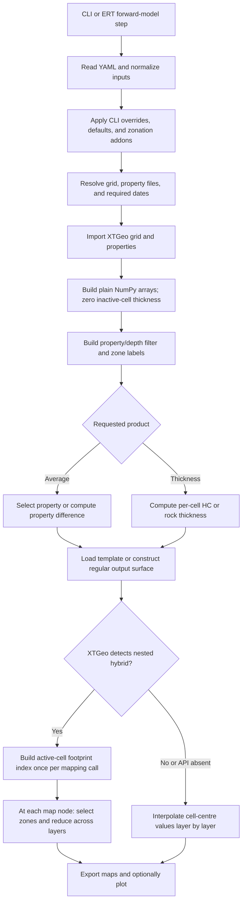
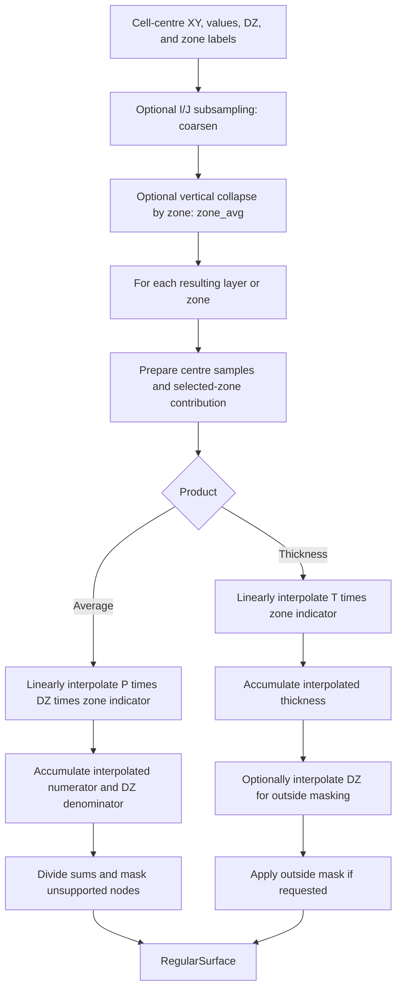
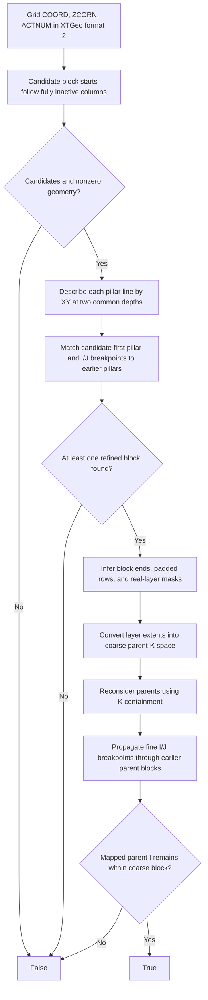
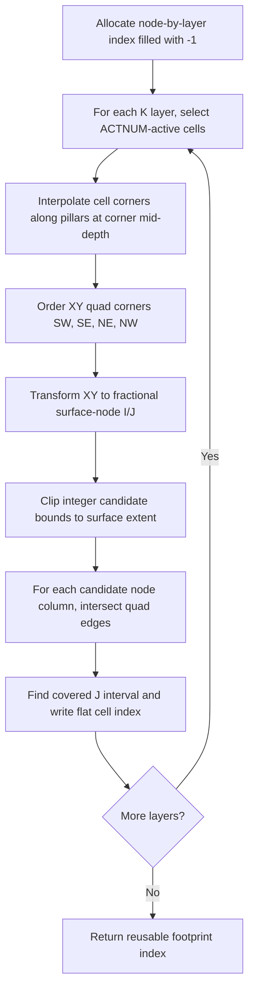
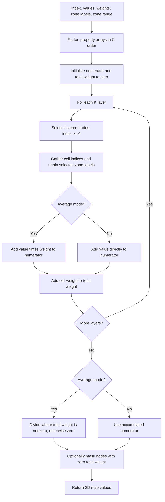

# grid3d-maps and XTGeo: architecture, algorithms, and current changes

Snapshot: 17 October 2026. Paths are relative to this workspace.
Flowcharts use Mermaid, which renders in GitHub Markdown and Mermaid-enabled viewers.

## 1. Scope and main result

The current work makes `grid3d-maps` aware of **nested hybrid grids**: grids where
refined regions are stored as additional logical blocks alongside the coarse grid.
These blocks occupy overlapping physical XY space, but the replaced coarse cells
are inactive.

Previously, map generation always interpolated values from cell centres. The new
path determines which active cell footprint covers each map node in each layer,
then averages or sums those cells directly. This avoids blending coarse and refined
blocks through a scattered-point interpolation.

| Repository | Compared with | Current state |
|---|---|---|
| `xtgeo` | Local `origin/main` at `600dc3d1` | Branch `nested-hybrid-footprint`, HEAD `de46c8a8`; three additional commits, clean worktree |
| `grid3d-maps` | Local `origin/main` and HEAD at `6f9ae7c` | Branch `nested-hybrid-footprint`; five modified tracked files and two untracked files |

This report includes the untracked mapper and its tests. It does **not** include
work on the separate local `main` or `nested-hybrid-v1` branches. Remote references
are the locally available references; no remote refresh was performed.

The explanations below describe the inspected implementation. Rationale inferred
from the code is distinguished from guarantees; test coverage means tests present
in the source, not a claim that those tests were executed for this report.

## 2. What grid3d-maps does

`grid3d-maps` converts 3D reservoir-grid properties into regular 2D maps without
starting RMS. XTGeo handles grid/property import, geometry, surface objects, and
the existing interpolation engine. `grid3d-maps` handles configuration, property
selection, filtering, zonation, physical calculations, export, and plotting.

| Entry point | Result |
|---|---|
| `grid3d_average_map --config config.yml` | Thickness-weighted property maps, including date differences |
| `grid3d_hc_thickness --config config.yml` | Oil, gas, combined hydrocarbon, or rock-thickness maps |
| ERT `GRID3D_AVERAGE_MAP` / `GRID3D_HC_THICKNESS` | The same commands run as forward-model steps |
| `contact/` source package | Incomplete contact-map prototype, not an installed CLI command |

Inputs are typically Eclipse `EGRID`, `INIT`, and `UNRST`, or ROFF grids/properties.
Outputs are XTGeo regular surfaces exported as `.gri` files or through
`fmu-dataio`, optionally accompanied by PNG plots from `xtgeoviz.quickplot`.
Calling the dataio exporter is not itself an explicit upload to Sumo in this code.

### 2.1 Overall execution



### 2.2 Source-code map

All paths in this table are under `grid3d-maps/src/grid3d_maps/`.

| Module | Responsibility |
|---|---|
| `__init__.py` | Exposes package version and configures package logging handlers |
| `version.py` | Build-generated version information, not mapping logic |
| `avghc/grid3d_average_map.py` | Average-map CLI and orchestration: configuration, import, filters, zones, mapping, plots |
| `avghc/grid3d_hc_thickness.py` | HC CLI and orchestration; expands `both` into separate oil and gas runs |
| `avghc/_configparser.py` | CLI parsing; YAML loading; date/property normalization; defaults, overrides, metadata, and zonation addons |
| `avghc/_loader.py` | Custom YAML safe loader; include/import directives and duplicate-key rejection |
| `avghc/_get_grid_props.py` | Resolves files, groups imports, loads properties, prepares geometry/saturation arrays, differences, and filters |
| `avghc/_get_zonation_filters.py` | Converts layer ranges or a discrete property into zone labels; resolves superzones |
| `avghc/_mapsettings.py` | Checks map/grid extent overlap or estimates map origin, dimensions, and increments |
| `avghc/_compute_avg.py` | Weighted-average mapping, map filenames/export, plot settings, and plots |
| `avghc/_compute_hcpfz.py` | Per-cell HC/rock-thickness formulas, saturation interval selection, and HC date differences |
| `avghc/_hc_plotmap.py` | Per-zone/per-date thickness mapping, export, filenames, and plots |
| `avghc/_nested_hybrid_mapping.py` | New shared nested-grid detection adapter and footprint-index reducer |
| `avghc/_export_via_fmudataio.py` | Creates dataio export metadata and exports average/HC surfaces |
| `contact/grid3d_contact_map.py` | Prototype orchestration for contact maps |
| `contact/_get_grid_props.py` | Older, separate import/array-preparation implementation for that prototype |
| `contact/_compute_contact.py` | Only creates a surface and logs properties; no contact calculation/export |
| `forward_models/grid3d_average_map.py` | ERT plugin wrapping the average-map CLI |
| `forward_models/grid3d_hc_thickness.py` | ERT plugin wrapping the HC-thickness CLI |
| `forward_models/__init__.py` | Exposes the two ERT plugin classes |
| `hook_implementations/jobs.py` | Registers both forward-model plugins; registers no workflow jobs |

The other package `__init__.py` files are package markers. Build directories,
bytecode caches, and `.egg-info` contain generated artifacts, not additional
mapping algorithms.

### 2.3 Configuration, import, filters, and zonation

Configuration is processed before numerical mapping:

1. Read YAML. `!include`/`!import` load files relative to the including file;
   `!include_from file::key.path` selects part of another YAML file using the
   supplied file path. The custom mapping constructor rejects duplicate keys.
2. Normalize HC dates or the average-map `properties` list. Dated average
   properties become identifiers such as `PRESSURE--20010101`; differences use
   `PRESSURE--20010101-19991201`. Metadata records property name and time labels.
3. Apply supported CLI overrides, defaults, optional external zonation YAML, and
   HC export metadata. `--dump` writes the processed configuration.
4. Resolve `$folderroot`/`$eclroot` where supported by the import path. A case root
   supplies `.EGRID`, `.INIT`, and `.UNRST`; an explicit grid can replace the
   derived grid path. Group properties sharing a file to reduce repeated imports.
5. Prepare arrays of shape `(grid.ncol, grid.nrow, grid.nlay)`. Inactive cells
   get zero thickness. Average geometry is stored in `specd`; HC geometry/static
   data in `initd`; time-dependent saturation data in `restartd`.

Filters form a 0/1 array `F` of that same shape. Continuous intervals, discrete
code selections or intervals, and cell-centre TVD intervals exclude cells.
Multiple filters combine as an intersection: once excluded, a cell stays excluded.
Depth filtering selects whole cells by their centres, not partial cell thickness.

Zonation can come from inclusive, 1-based K ranges (`zranges`) or selected codes
in a discrete property (`zproperty`), but not both. Named zones are encoded as
positive integers. Superzones combine named zones, including nonconsecutive ones.
The mapping routines relabel selected superzone members to `888`; `all` relabels
every cell to `999`. The `all` selection therefore includes cells outside named
zones. `computesettings.zone` and `.all` control which products are generated.
Layer ranges refer to the imported grid's K indices, including inserted layers.

If no map geometry is supplied, `_mapsettings.py` estimates it from grid extents:
about 5% padding on each side and increments equal to half the average of grid
DX and DY. This is a convenience estimate, **not a guarantee of resolving the
smallest refined cells**. A template supplies its own geometry; explicit numeric
settings construct an unrotated surface. The current overlap check logs a critical
message for a disjoint extent but its callers do not terminate at that point.

## 3. Numerical products

### 3.1 Weighted average

For property `P`, thickness `DZ`, and filter `F`, define `W = DZ * F`.
At a nested-grid map node `s`, let `C(s)` be the active cells selected by the
footprint index across layers and belonging to the requested zone:

```text
average(s) = sum(P[c] * W[c] for c in C(s)) / sum(W[c] for c in C(s))
```

This is a thickness-weighted average, not a porosity-, volume-, or area-weighted
average. The standard path instead interpolates numerator and denominator onto
the map before taking their ratio, as described in section 4.
Property differences are computed per cell before mapping: `P(date1)-P(date2)`.
For example, values `10` and `20` with thicknesses `1` and `3` yield `17.5`;
filtering out the second cell yields `10`.

### 3.2 HC and rock thickness

`_compute_hcpfz.py` calculates a per-cell thickness contribution `T`.
The name HCPFZ denotes an HC fraction already multiplied by thickness; the
mapping stage must **not multiply it by DZ a second time**.

| Input/method | Per-cell contribution before vertical reduction |
|---|---|
| `use_poro` | `T = PORO * NTG * SHC * DZ * F` |
| `use_porv` | `T = PORV * SHC * F / max(DX*DY, 10.0)` |
| Direct `xhcpv` input | `T = XHCPV * F / max(DX*DY, 10.0)` |
| `dz_only` | `T = DZ * F` where saturation is in the selected interval, otherwise zero |
| Rock mode | `T = geometric DZ * F`, without requiring HC properties |

The hard-coded `10.0` area floor is existing behavior and matters for very small
cells. These volume/area formulas give thickness only when the inputs have
compatible units and represent the intended volume quantity.

Oil saturation is derived as `1-SWAT-SGAS`, optionally reduced by the configured
critical-saturation property. Oil and gas are clipped to `[0,1]` and zeroed in
inactive cells. `oil` selects oil saturation, `gas` selects gas, `comb` adds
them, and `both` produces separate oil and gas outputs.
For the applicable methods, saturation outside `shc_interval` contributes zero;
it is excluded rather than clamped to the interval boundary.

For nested mapping, `thickness(s) = sum(T[c] for c in C(s))`.
HC date differences are also calculated before mapping as `T(date1)-T(date2)`.
Intermediate dates are removed unless separately requested.

### 3.3 Outputs and integration

Average maps are collected as `{(zone, property_identifier): RegularSurface}`;
HC maps as `{zone: {date_identifier: RegularSurface}}` for each phase run.
Regular file export uses zone, optional tag, product, and date in the filename;
the all-zone prefix can be overridden. Average `mask_zeros` optionally masks
near-zero results. Plotting adds labels, ranges, colormaps, and optional faults.

Dataio export attaches zone, attribute, unit, tag, and monitor/base dates.
Average export requires matching property metadata; HC metadata is derived from
the configured product. The old `input.fmu_global_config` option is deprecated.
ERT wrappers supply the YAML configuration and optional Eclipse root to the same
CLIs; they do not implement a second numerical pipeline.

## 4. Existing algorithm: cell-centre interpolation

Both existing surface APIs delegate to XTGeo's
`avgsum_from_3dprops_gridding()` in
[`_regsurf_gridding.py`](xtgeo/src/xtgeo/surface/_regsurf_gridding.py).
This implementation uses SciPy linear scattered-point interpolation.



`coarsen=N` takes every Nth I/J sample; it is subsampling, not conservative
upscaling. `zone_avg=True` collapses each zone vertically before gridding:
coordinates are averaged, DZ and thickness contributions summed, and average
properties thickness-weighted. Both options trade detail for computation time.

Linear interpolation fills outside the sample convex hull with zero. Average
maps mask nodes without interpolated thickness support; HC maps optionally do
so through `mask_outside`. The existing summing implementation can skip a layer
whose whole-array contribution sums to approximately zero (`1e-12` tolerance).
The new nested reducer does not contain that shortcut.

### Why nested grids need a different route

An appended refined block is adjacent to its parent in **logical array storage**
but overlaps it in **physical coordinates**. A scattered interpolation sees
samples, not parent/child ownership or cell edges. Coarse inactive centres remain
in the input arrays with zeroed weights/contributions, and triangulation can
blend across refinement boundaries or gaps. Reducing the map increment does not
fix that underlying sampling model.

The new route uses geometry and ACTNUM to select the active cell at the node,
without triangulating cell-centre samples. This preserves sharp cell boundaries
at the sampled locations. It does not create information finer than either the
grid geometry or the output-node spacing.

## 5. XTGeo changes: what and why

Relative to local `origin/main`, XTGeo adds four files/changes totalling
447 inserted lines, with no deleted lines in the final branch diff:

| File | Change | Purpose |
|---|---|---|
| `src/xtgeo/grid3d/grid.py` | Imports two modules and adds two public `Grid` methods; 32 lines | Exposes geometry capabilities where grid data is owned |
| `src/xtgeo/grid3d/_grid_nested_hybrid.py` | New detector; 178 lines | Recognizes the merged-block representation without external metadata |
| `src/xtgeo/grid3d/_grid_footprint.py` | New footprint index builder; 100 lines | Separates reusable geometric lookup from property reductions |
| `tests/test_grid3d/test_grid_nested_hybrid.py` | New tests; 137 lines | Covers detection and footprint sampling |

Commit progression:

| Commit | What it introduces | Design rationale |
|---|---|---|
| `2f22326d` | `Grid.is_nested_hybrid()` | Enables automatic routing from grid structure rather than a new user configuration switch |
| `281fa4df` | `Grid.get_cell_footprint_index(surface)` | Builds one reusable node-to-cell lookup for many properties, dates, and zones |
| `de46c8a8` | Scanline footprint filling | Replaces nested candidate-node loops and triangle tests with interval filling and vectorized writes |

The last commit changes how the index is built, not the intended public result.
Its loop structure suggests reduced Python overhead; no measured speedup is
claimed here.

### 5.1 Geometry-only nested-hybrid detection

Source: [`_grid_nested_hybrid.py`](xtgeo/src/xtgeo/grid3d/_grid_nested_hybrid.py).

Expected layout: a coarse block followed along I by refined blocks, separated by
one inactive column, with each block beginning at the first logical J row.
Vertical refinement is represented by extra, zero-thickness layers in coarser
blocks, as produced by `xtgeo.grid_merge` with layer maps.
This is detection of that representation, not arbitrary simulator LGR metadata.



Important implementation details:

* `_pillar_keys()` interpolates/extrapolates each pillar line to two shared
  reference depths, chosen from median nonzero-pillar endpoint depths. Matching
  is therefore independent of where endpoints lie along the same pillar line.
* XY matching uses an absolute tolerance of `1e-2` in coordinate units.
* `_find_parent_pillar()` prefers later matching I positions, allowing attachment
  to an already refined block. It checks the next parent I/J breakpoints and,
  in the second pass, the child's ending I pillar and K containment.
* `_real_layers()` detects row padding and marks a layer real when it has
  thickness greater than the tolerance or contains active cells. The coarse
  real-layer cumulative sum maps inserted layers into parent-K space.
* `_breakpoints()` propagates coarse-cell ownership between matching fine
  pillars. Internal I/J/level arrays resolve nested refinement, but the public
  method returns only a boolean, not those mappings.

This is a structural heuristic, **not a complete geometry validator**.
In particular, it does not prove that all child geometry is a valid subdivision,
that active parent/child overlaps are absent, or that refined Z values physically
match their parent. The implementation does inspect ZCORN to determine real-layer
masks for blocks, even though its module introduction says refined Z is never read.
The parent reconsideration also retains the earlier match when its stricter
search finds none, so K checks are not an unconditional rejection gate.

### 5.2 Surface-node footprint index

Source: [`_grid_footprint.py`](xtgeo/src/xtgeo/grid3d/_grid_footprint.py).

Public contract:

```python
index = grid.get_cell_footprint_index(surface)
# Shape: (surface.ncol, surface.nrow, grid.nlay)
# Value: C-order flat grid-cell index, or -1 when uncovered
```

For a cell `(i,j,k)`, the stored index is `(i*grid.nrow+j)*grid.nlay+k`.
It can therefore index a property flattened in C order directly.
The dtype is `int32` when the total cell count is below the signed 32-bit maximum,
otherwise `int64`. This API also works on regular grids; nested-grid detection
is a caller-side routing decision, not a requirement inside the index builder.



Each corner's mid-depth is the mean of its top and bottom ZCORN depths; its XY is
interpolated along the corresponding COORD pillar. Thus this is the quad joining
the **four corner midpoints**, not a full 3D vertical-ray/cell intersection.

The world-to-node transform handles surface rotation `theta` and `yflip`:

```text
u = ((x-xori)*cos(theta) + (y-yori)*sin(theta)) / xinc
v = ((y-yori)*cos(theta) - (x-xori)*sin(theta)) / (yinc*yflip)
```

Scanline filling intersects each integer `u` with the quad edges and fills integer
J positions between minimum and maximum intersections. Near-vertical edges are
handled explicitly; an epsilon of `1e-9` in fractional node coordinates includes
boundaries. This interval approach assumes a simple footprint whose intersection
with a scanline is one interval, as for a convex quad. General concave, folded, or
self-intersecting footprints are not validated by this routine.

Inactive parent cells never enter rasterization, so correctly deactivated
parents do not compete with refined children. There is **no explicit finest-cell
priority** if multiple active cells cover the same node/layer. Shared boundaries
or genuine active overlaps can write the same index slot; the routine does not
return all candidates or resolve them by refinement level.

## 6. grid3d-maps changes: what and why

The tracked diff has 61 insertions and 25 deletions. Two additional untracked
files add 173 lines and are essential to the implementation.

| File under `grid3d-maps/` | Change | Why |
|---|---|---|
| `src/grid3d_maps/avghc/_nested_hybrid_mapping.py` | New 58-line detector adapter and reducer | Shares nested-grid sampling between average and HC products |
| `src/grid3d_maps/avghc/_compute_avg.py` | `get_avg()` receives `grd`; computes index before zone/property loops; routes nested grids to reducer | Uses active-cell ownership and reuses geometry |
| `src/grid3d_maps/avghc/_hc_plotmap.py` | `do_hc_mapping()` receives `grd`; computes index before zone/date loops; uses sum mode | Sums already thickness-scaled contributions without double weighting |
| `src/grid3d_maps/avghc/grid3d_average_map.py` | Passes `grd` into `get_avg()` | Wires imported geometry into the mapper |
| `src/grid3d_maps/avghc/grid3d_hc_thickness.py` | Passes `grd` into `do_hc_mapping()` | Same wiring for thickness |
| `tests/test_nested_hybrid_mapping.py` | New 115-line integration-oriented unit tests with a fake nested grid | Checks both mapping callers choose the new path and reuse their index |
| `docs/howitworks.rst` | Adds explanation of direct nested mapping | Documents the different sampling model and ignored tuning shortcuts |

There is no new CLI option, YAML schema, dependency requirement, or export format.
Non-nested grids continue through the old APIs. The changed helper signatures are
internal Python interfaces; downstream code calling them directly must pass `grd`.

### 6.1 Shared nested reducer

Source: [`_nested_hybrid_mapping.py`](grid3d-maps/src/grid3d_maps/avghc/_nested_hybrid_mapping.py).



In average mode, weights are `geometric DZ * filterarray`.
In HC sum mode, values are the already filtered HCPFZ contributions; weights are
`initd["dz"]` and are used only to determine coverage for `mask_outside`.
Consequently an HC cell excluded by a property or saturation filter contributes
zero but can still leave the node defined when geometric thickness is present.

The index is constructed once per call to `get_avg()` or `do_hc_mapping()`, not
once per zone/date/property. It is not persisted on disk or cached across calls.
In `both` mode, separate oil/gas mapping calls rebuild it.
The reducer traverses all output nodes for every layer for each output map:
roughly `O(surface.ncol * surface.nrow * grid.nlay)` work per reduction, plus
temporary gathers. Index construction adds active-cell geometry and scanline work.

The full index has that same three-dimensional size even where coverage is sparse.
For example, `1000*1000` nodes over `100` layers require approximately 400 MB
for an `int32` index alone, or 800 MB for `int64`, excluding all other arrays.

### 6.2 Observable behavior and limitations

| Topic | Current behavior |
|---|---|
| Spatial reconstruction | Nested path is cellwise sampling, not smooth interpolation or nearest-centre selection |
| Refinement | Follows active footprints, not a user-defined refinement threshold |
| Map resolution | Only samples map nodes; a fine cell between nodes can be missed |
| Conservation | No map-pixel/cell area intersections or conservative areal redistribution |
| `coarsen`, `zone_avg` | Ignored on the nested path; still applied on the standard path |
| Average no-data | Reducer returns zero where selected total weight is zero; average caller does not request outside masking |
| Average zero masking | Optional `mask_zeros` masks near-zero output, including legitimate near-zero averages |
| HC no-data | Zero unless `mask_outside=True`; outside mask is based on summed DZ, not summed HC |
| Boundary/overlap selection | No explicit tie-break contract or finest-level comparison |
| Vertical interpretation | One mid-depth footprint per cell per K; no continuous vertical-ray integration |
| Data validity | Reducer expects aligned plain arrays; it does not independently validate shapes or sanitize invalid property values |
| Older XTGeo | Missing `is_nested_hybrid` is treated as false, silently selecting standard interpolation |
| Partial API availability | Detection returning true requires `get_cell_footprint_index`; otherwise that call fails |

Two especially important deployment details:

1. `pyproject.toml` still allows `xtgeo>=2.20.7`; it does not require the new APIs.
   Installing `grid3d-maps` alone therefore does not guarantee nested-aware mapping.
2. Zero weights are not an invalid-value guard: e.g. `NaN * 0` is still NaN.
   Array preparation must provide usable values and correct grid alignment.

The change preserves the existing path for regular grids, but does **not** aim
to make nested results numerically identical to interpolated results.
Different boundaries, no-data handling, and lack of interpolation are intentional
or implementation-visible consequences of the new sampling model.

## 7. Evidence and coverage boundaries

XTGeo's new test file contains ten tests:

* Regular grids rejected; single and double nesting detected.
* Detection after an EGRID roundtrip.
* Drogon/emerald nested fixtures accepted and an original emerald grid rejected.
* Correct C-order lookup for a regular grid.
* Rotated surface sampling and out-of-grid `-1` values.
* Refined cells selected in a synthetic nested grid, with inserted-layer gaps.

The two new `grid3d-maps` tests use a fake grid with a known footprint index:

* Average mapping selects the requested zone's values and builds its index once.
* HC mapping sums the requested zone's contributions, masks an uncovered node,
  and builds its index once.

Those two tests exercise the caller wiring but not real XTGeo geometry. Each
selects one contributing layer per covered node, so they do not directly establish
multi-layer unequal-weight averaging or multi-layer HC accumulation.
Neither new suite establishes conservative volume preservation, runtime/memory
thresholds, arbitrary active overlaps, distorted/concave footprints, invalid
property values, or complete equivalence of all export and configuration modes.
Negative `yflip` support is in the transform but has no dedicated new test.
Some detector tests depend on external XTGeo test data.

Existing `tests/test_scripts/` files cover the established average/HC scripts
and dataio scenarios; `tests/test_vs_ert/` covers plugin integration.
The contact-map test is explicitly skipped as unfinished.

## 8. How to read or debug the pipeline

Start with the appropriate CLI `main()`, then follow:

```text
_configparser / _loader
    -> _get_grid_props
    -> _get_zonation_filters
    -> _compute_avg OR _compute_hcpfz + _hc_plotmap
    -> nested route: XTGeo detector -> footprint index -> nested_hybrid_map
       standard route: XTGeo avgsum_from_3dprops_gridding
    -> _export_via_fmudataio OR RegularSurface.to_file
    -> optional quickplot
```

For unexpected nested-map results, inspect detection first, then output-node
spacing, ACTNUM and footprint coverage (`index >= 0`), selected zone labels,
and finally property values/weights. For HC results, inspect the per-cell HCPFZ
contribution separately from mapping: it already includes the thickness or
volume-to-area conversion and filtering.

Primary source entry points:

* [Average CLI](grid3d-maps/src/grid3d_maps/avghc/grid3d_average_map.py),
  [average mapper](grid3d-maps/src/grid3d_maps/avghc/_compute_avg.py).
* [HC CLI](grid3d-maps/src/grid3d_maps/avghc/grid3d_hc_thickness.py),
  [HC calculations](grid3d-maps/src/grid3d_maps/avghc/_compute_hcpfz.py),
  [HC mapper](grid3d-maps/src/grid3d_maps/avghc/_hc_plotmap.py).
* [Import and filters](grid3d-maps/src/grid3d_maps/avghc/_get_grid_props.py),
  [zonation](grid3d-maps/src/grid3d_maps/avghc/_get_zonation_filters.py).
* [XTGeo public Grid methods](xtgeo/src/xtgeo/grid3d/grid.py),
  [XTGeo tests](xtgeo/tests/test_grid3d/test_grid_nested_hybrid.py),
  [grid3d-maps tests](grid3d-maps/tests/test_nested_hybrid_mapping.py).
